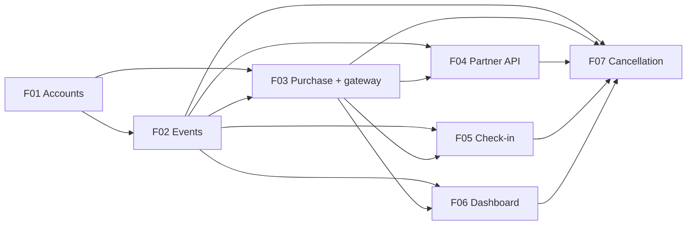

# PRD — Catraca MVP

- **Source**: `docs/brief.md` (rules R01–R13, partner API contract, evaluator flow). The brief wins on any conflict.
- **Status**: draft for review
- **Audience**: implementer and evaluator agents (see `AGENTS.md`)

## 1. Problem and goal

The first attempt shipped features that worked alone and broke together: a cancelled event still let
people in, the dashboard counted refunds as revenue, and a 100-seat show sold 112 tickets.

Goal: an MVP where every rule R01–R13 holds **across features**. Every dependency between features has
at least one cross-feature acceptance criterion, and every criterion is verified by an evaluator that did
not implement it.

## 2. Users

| Role | How they get in | What they do |
|---|---|---|
| Visitor | no login | browses the storefront |
| Participant | signs up in the product (name, e-mail, password) | logs in/out, buys tickets on the storefront, sees "Meus ingressos" |
| Organizer | seed only (A and B) | creates and operates **own** events in the organizer area |
| Partner | `X-Api-Key` header | lists events, buys tickets and reads tickets through the partner API |

## 3. Global decisions (binding for all features)

These keep features that are built in parallel compatible. A spec may refine them but not contradict them.

| Topic | Decision |
|---|---|
| Time zone | `America/Sao_Paulo`. Forms use `datetime-local` read as `-03:00`. The API returns `startsAt` as ISO 8601 with offset (e.g. `2026-12-05T21:00:00-03:00`). "Future" means `starts_at > now()`. |
| Money | Integer cents. Forms accept `100`, `100,00` or `100.00`; the UI shows `R$ 1.234,56`. |
| Event status | `draft` → `published` → `cancelled` (column `events.status`). There are no other transitions. |
| Ticket status | `pending`, `confirmed`, `declined`, `cancelled`, `refunded` (column `tickets.status`). UI labels: pendente, confirmado, recusado, cancelado, estornado. Check-in is a separate field (`tickets.checked_in_at`). |
| Ticket code | 8 characters from the `src/lib/ids.ts` alphabet, uppercase, unique (DB constraint, retry on collision). |
| Seats | `occupied = count(pending + confirmed)`; `available = capacity − occupied`, or `0` if the event is cancelled. One function owns this calculation (F03); nobody else recomputes it. |
| Concurrency | Every write that can change `occupied` or `capacity` locks the event row (`SELECT … FOR UPDATE`) inside a transaction. |
| Gateway | Persisted jobs; results are applied with `UPDATE … WHERE status = 'pending'`. |
| Ownership | Organizer queries always filter by `organizer_id = current user`. Another organizer's event → 404 page with no event data. |
| Main routes | Storefront `/`, event page `/events/:id`, `/signup`, `/login`, `POST /logout`, `/my-tickets`, organizer area `/organizer/events`, management page `/organizer/events/:id`, partner API `/api/partner/...`. |
| Management page composition | F02 provides a section registry (`registerManagementSection`). F05 (check-in), F06 (dashboard) and F07 (cancellation) each add their own section and routes in their own module, without editing each other's files. |

## 4. Features

| ID | Name | Wave | Module(s) |
|---|---|---|---|
| F01 | Accounts and access | 1 | `src/auth/`, `src/ui/` |
| F02 | Event management and storefront listing | 2 | `src/events/` |
| F03 | Ticket purchase and simulated gateway | 3 | `src/tickets/`, `src/gateway/` |
| F04 | Partner API | 4 | `src/partner-api/` |
| F05 | Check-in | 4 | `src/checkin/` |
| F06 | Event dashboard | 4 | `src/dashboard/` |
| F07 | Event cancellation | 5 | `src/cancellation/` |

### F01 — Accounts and access

**Provides**
- `sessions` table and a session cookie (`catraca_session`, httpOnly).
- Routes `GET/POST /signup` (participants only), `GET/POST /login`, `POST /logout`.
- Fastify preHandlers `requireUser`, `requireParticipant`, `requireOrganizer`; `request.user = { id, name, email, role } | null`.
- UI shell: `renderPage({ title, body, user })` with navigation (Vitrine, Meus ingressos, Área do organizador, Entrar/Sair) and an HTML-escape helper.

**Consumes**
- Harness: `users` table and seed users.

**Acceptance criteria**
- **F01-AC1** A visitor can create an account with name, e-mail and password. The account has role `participant` and the participant is logged in afterwards. A missing field, a malformed e-mail or an already-used e-mail is rejected with a message and no account is created.
- **F01-AC2** The seed accounts (organizer A, organizer B, participant) log in with the README credentials. A wrong password is rejected.
- **F01-AC3** Logout ends the session: after `POST /logout`, protected pages redirect to `/login`.
- **F01-AC4** (R13) The organizer area (`/organizer/*`) redirects visitors to `/login` and answers participants with 403. Signup ignores any `role` field and can never create an organizer.
- **F01-AC5** Passwords are never stored in plain text.

### F02 — Event management and storefront listing

**Provides**
- `events` table: `id`, `organizer_id`, `name`, `starts_at`, `venue`, `capacity`, `price_cents`, `status`, timestamps.
- Domain: `createEvent`, `updateEvent` (with a validation hook used by F03 for capacity), `publishEvent`, `getOwnedEvent(organizerId, eventId)` (returns `null` for other organizers), `listOwnedEvents(organizerId)`, `listOnSaleEvents()` (published and not cancelled).
- Pages: `/organizer/events` (own list), `/organizer/events/new`, management page `/organizer/events/:id` (edit form + publish button + section registry), storefront `/` and event page `/events/:id`.

**Consumes**
- F01: `requireOrganizer`, `request.user`, `renderPage`.

**Acceptance criteria**
- **F02-AC1** (R01) An organizer creates an event with name, start date and time, venue, capacity (integer ≥ 1) and price (> 0). Each invalid value (empty name or venue, capacity 0 or non-integer, price 0 or negative) is rejected with a message and nothing is saved.
- **F02-AC2** (R01) A start date in the past (e.g. yesterday) is rejected on create **and** on edit.
- **F02-AC3** (R02) A new event is a draft and does not appear on the storefront. After it is published it appears on the storefront with name, date, venue and price.
- **F02-AC4** (R04) Each event has its own management page URL (`/organizer/events/:id`) where the owner edits it and publishes it. Publish is offered only for drafts.
- **F02-AC5** (R13) Organizer B's event list does not show organizer A's events. Opening A's management URL as B returns a 404 page with no event data (no name, numbers or tickets). B's edit/publish POSTs to A's event return 404 and change nothing.
- **F02-AC6** (R03) Editing the price or increasing the capacity of an own event is accepted and visible on the management page and the storefront.

**Cross-feature**
- **X-F01-F02-1** (R13) With a real event of organizer A, `/organizer/events/:id`: a visitor is redirected to `/login`, the seed participant gets 403, and neither response contains the event name.

### F03 — Ticket purchase and simulated gateway

**Provides**
- `tickets` table: `id`, `event_id`, `buyer_user_id` (nullable), `buyer_email`, `code` (unique), `status`, `price_cents_paid`, `channel` (`storefront` | `partner`), `checked_in_at`, timestamps.
- `payment_jobs` table and gateway worker (`startGatewayWorker`), resolved per the brief's card table; delay multiplied by `GATEWAY_DELAY_SCALE`.
- Domain: `purchaseTicket({ eventId, buyerUserId?, buyerEmail, cardNumber, channel })` → `{ ok: true, ticket } | { ok: false, error: "invalid_card" | "event_not_available" | "sold_out" }`; `seatStats(eventId)` → `{ capacity, occupied, available }`; `getTicket(id)`; `findTicketByCode(code)`; `applyGatewayResult(ticketId, approved)` (pending-only).
- Capacity guard hooked into F02's `updateEvent`, which rejects `capacity < occupied` under the event lock.
- UI: purchase form (card number) on `/events/:id` for participants, `Ingressos esgotados` when there are no seats, `/my-tickets`.

**Consumes**
- F01: `requireParticipant`, `request.user`, `renderPage`.
- F02: `events` table, `listOnSaleEvents`, event page, `updateEvent` validation hook.

**Acceptance criteria**
- **F03-AC1** (R06) A logged-in participant buys one ticket on the event page. The answer does not wait for the gateway, and "Meus ingressos" immediately shows the ticket as `pendente`.
- **F03-AC2** (R08) With `GATEWAY_DELAY_SCALE=1`: card ending `0001` → `confirmado` within 2–5 s; `0002` → `recusado` within 2–5 s; `0003` → `confirmado` within 30–40 s; `0004` → `recusado` within 30–40 s; any other ending → `recusado` within 2–5 s.
- **F03-AC3** A card number that is not exactly 16 digits is rejected before creating a ticket (the ticket count does not change).
- **F03-AC4** (R05, R06, R08) A pending ticket occupies a seat until the gateway answers. A decline frees the seat (`available` goes back up by 1).
- **F03-AC5** (R07) With no available seats, the event page shows `Ingressos esgotados` instead of the purchase form, and a purchase attempt (e.g. a stale form) answers `Ingressos esgotados` without creating a ticket.
- **F03-AC6** (R07) Concurrency: an automated test in the gates fires 30 concurrent `purchaseTicket` calls on a fresh event with capacity 5 and gets exactly 5 successes and 25 `sold_out`, repeated for at least 5 fresh events. `occupied` never exceeds `capacity`.
- **F03-AC7** (R09) Each ticket has a unique 8-character code. "Meus ingressos" lists, for the logged-in participant only, each ticket's event name, status label and code.
- **F03-AC8** (R03) Each ticket stores the price in force at purchase time. Changing the event price affects only purchases made afterwards.
- **F03-AC9** (R08, R11) A gateway result is applied only to a ticket that is still `pending`. Applying a result to a `cancelled`, `refunded`, `confirmed` or `declined` ticket changes nothing (automated test).
- **F03-AC10** Gateway jobs survive an app restart: a pending job created before `docker compose restart app` is still resolved afterwards.

**Cross-feature**
- **X-F01-F03-1** (R09) Buying requires a participant session. A visitor who clicks buy is sent to `/login`, and an organizer sees no purchase form. Participant P1 does not see participant P2's tickets in "Meus ingressos".
- **X-F02-F03-1** (R02) A draft event cannot be bought, not even by a direct POST (rejected, no ticket). Once published, it can.
- **X-F02-F03-2** (R03, R05) On the management page, reducing capacity below occupied seats (pending + confirmed) is rejected with a message. Increasing it is accepted, and the new seats can be bought on the storefront.
- **X-F02-F03-3** (R03) After the price is edited on the management page, the next purchase stores the new price while earlier tickets keep the old one.

### F04 — Partner API

**Provides**
- `GET /api/partner/events`, `POST /api/partner/events/:eventId/purchases`, `GET /api/partner/tickets/:ticketId`, exactly as in `docs/brief.md`.
- `X-Api-Key` preHandler (key from `PARTNER_API_KEY`).

**Consumes**
- F02: `listOnSaleEvents`.
- F03: `purchaseTicket` (channel `partner`), `seatStats`, `getTicket`.

**Acceptance criteria**
- **F04-AC1** (R02, R05) `GET /api/partner/events` → 200 with a JSON array of exactly `{ id, name, startsAt, priceCents, availableSeats }` for published, non-cancelled events only. `availableSeats` equals R05.
- **F04-AC2** (R06) A valid purchase → 202 `{ ticketId, code, status: "pending" }`, answered without waiting for the gateway.
- **F04-AC3** (R07) The error order is: 422 `invalid_request` (missing field, malformed e-mail, card not 16 digits, e.g. `"123"`) → 404 `event_not_available` (unknown, draft or cancelled event) → 409 `sold_out`. For example, an invalid body on a draft event gives 422, and a valid body on a draft event gives 404.
- **F04-AC4** `GET /api/partner/tickets/:id` → 200 `{ ticketId, code, eventId, status, checkedIn }` for a ticket from any channel. An unknown id → 404 `ticket_not_found`.
- **F04-AC5** All three routes answer 401 `{"error":"unauthorized"}` without the header and with a wrong key. The key check comes before any other error.
- **F04-AC6** (R07) The brief's burst (`seq 30 | xargs -P 30 …`) on two fresh events with capacity 5 gives exactly 5 × `202` and 25 × `409` each time.

**Cross-feature**
- **X-F02-F04-1** (R02) An event created as a draft through the organizer UI is absent from `GET /api/partner/events`. After it is published in the UI, it is present with `availableSeats` = capacity and `priceCents` = the price typed in the UI.
- **X-F03-F04-1** (R05, R06, R08) A ticket bought through the API occupies a seat in both channels: when it takes the last seat, the API shows `availableSeats: 0` and the storefront shows `Ingressos esgotados`. Card `0004` → `declined` after 30–40 s and the seat comes back. Card `0001` → `confirmed` within 5 s.
- **X-F03-F04-2** (R09) A ticket bought on the storefront is returned by `GET /api/partner/tickets/:id` with the same code and status shown in "Meus ingressos".

### F05 — Check-in

**Provides**
- Check-in section on the management page (code field + message) via `registerManagementSection`.
- Domain: `checkIn(organizerId, eventId, code)` → one of the five R10 messages.

**Consumes**
- F02: management page, section registry, `getOwnedEvent`.
- F03: `tickets` (status, code, `checked_in_at`).

**Acceptance criteria**
- **F05-AC1** (R10) The message is the first true condition, in order, with the exact text:
  1. unknown code or code of another event → `Ingresso inválido para este evento`
  2. event cancelled → `Evento cancelado`
  3. ticket not confirmed (pending, declined) → `Ingresso não confirmado`
  4. already checked in → `Ingresso já utilizado`
  5. otherwise → `Entrada liberada` (and the ticket is marked as checked in)
- **F05-AC2** (R10) Precedence: a confirmed code from another event → `Ingresso inválido para este evento`. A pending ticket of a cancelled event (status set directly in the DB in the test, since F07 does not exist yet) → `Evento cancelado`.
- **F05-AC3** (R10) Two simultaneous check-ins of the same confirmed code produce exactly one `Entrada liberada` and one `Ingresso já utilizado`.

**Cross-feature**
- **X-F02-F05-1** (R04, R13) Check-in is available only on the owner's management page. Organizer B posting a valid code to A's event check-in route gets 404 and the ticket is not checked in.
- **X-F03-F05-1** (R09, R10) The code shown in "Meus ingressos" for a confirmed storefront ticket gives `Entrada liberada` on that event's check-in, and the ticket is then recorded as checked in.

### F06 — Event dashboard

**Provides**
- Dashboard section on the management page via `registerManagementSection`.
- Domain: `eventDashboard(eventId)` → `{ confirmed, pending, checkIns, availableSeats, revenueCents, refunded }`.

**Consumes**
- F02: management page, section registry, `getOwnedEvent`.
- F03: `tickets`, `seatStats`.

**Acceptance criteria**
- **F06-AC1** (R12, R05) The dashboard shows: Confirmados (confirmed, including checked in), Pendentes, Check-ins (confirmed with check-in), Vagas disponíveis (R05), Receita (sum of `price_cents_paid` of confirmed tickets, shown as `R$ 0,00`) and Estornados (refunded).
- **F06-AC2** (R12) Declined and cancelled tickets are counted in none of the numbers, and refunded tickets add nothing to Receita.
- **F06-AC3** (R12) The numbers are computed from tickets at render time, with no stored counters. A reload after a gateway answer shows the new numbers.

**Cross-feature**
- **X-F02-F06-1** (R04, R13) The dashboard appears on the owner's management page. Organizer B opening A's page sees no dashboard numbers (404).
- **X-F03-F06-1** (R03, R12) Two confirmed tickets at R$ 100,00, then a price change to R$ 150,00 and a third confirmed ticket → Receita `R$ 350,00`, Confirmados 3.

### F07 — Event cancellation

**Provides**
- Cancel action on the management page (section) and `cancelEvent(organizerId, eventId)`.

**Consumes**
- F02: event status, management page, `updateEvent`/`publishEvent` (blocked after cancel), section registry.
- F03: tickets, `payment_jobs`, pending-only `applyGatewayResult`, `seatStats`.
- F04: partner routes (behavior after cancel).
- F05: check-in (message after cancel).
- F06: dashboard (numbers after cancel).

**Acceptance criteria**
- **F07-AC1** (R11) The owner can cancel a **published** event (drafts show no cancel action). Cancelling is irreversible: the event cannot be edited or republished, and the corresponding POSTs are rejected without changes.
- **F07-AC2** (R11) Within 10 s of cancelling, confirmed tickets become `refunded` and pending ones become `cancelled`.
- **F07-AC3** (R11, R08) A gateway answer that arrives after the cancellation (slow card `0003`, checked 45 s after purchase) does not change the ticket: it stays `cancelled`.
- **F07-AC4** (R11, R02) The cancelled event disappears from the storefront and cannot be bought on its event page.
- **F07-AC5** (R05, R11) A cancelled event has 0 available seats.

**Cross-feature**
- **X-F02-F07-1** (R04, R11) The management page of a cancelled event shows no edit form and no publish action, and the edit/publish routes reject changes.
- **X-F03-F07-1** (R08, R11) A pending ticket whose payment job is still scheduled when the event is cancelled ends up `cancelled` after the job runs, never `confirmed` or `declined`.
- **X-F04-F07-1** (R11) After cancellation, the event is absent from `GET /api/partner/events`, `POST …/purchases` returns 404 `event_not_available`, and `GET /api/partner/tickets/:id` shows `refunded` / `cancelled`.
- **X-F04-F07-2** (R05, R10, R11, R12) API purchases count exactly like storefront ones: on one event with tickets bought through both channels, the dashboard counts both, check-in accepts both codes, and cancellation refunds or cancels both.
- **X-F05-F07-1** (R10, R11) On a cancelled event, the code of a formerly confirmed ticket gives `Evento cancelado`, either in place of the field or as the check-in answer. A code from another event still gives `Ingresso inválido para este evento`.
- **X-F06-F07-1** (R11, R12) Evaluator-flow scenario (5 seats, one confirmed, one slow pending, then cancel): the dashboard shows Confirmados 0, Pendentes 0, Check-ins 0, Vagas disponíveis 0, Receita R$ 0,00 and Estornados 1, also after the slow gateway answer.

## 5. Dependency graph and waves

| Wave | Features | Mode | Why |
|---|---|---|---|
| 1 | F01 | sequential | Everything needs sessions and roles. |
| 2 | F02 | sequential | Events are the base of tickets. |
| 3 | F03 | sequential | The seat, price and gateway core that every later feature reads. |
| 4 | **F04, F05, F06** | **parallel** (one branch/worktree each, PRs to `main`) | All three consume only F02 + F03, live in separate modules, and meet only through the management section registry. Expected conflicts: `src/app.ts` route registration and `project-state.json`. |
| 5 | F07 | sequential | Changes behavior seen by F03–F06, so it goes last and verifies the effects there. |

### Edge → cross-feature criteria

Each cross-feature criterion goes in the contract of the **consuming** feature (the right side of the edge).

| Edge | Criteria | Contract |
|---|---|---|
| F01 → F02 | X-F01-F02-1 | F02 |
| F01 → F03 | X-F01-F03-1 | F03 |
| F02 → F03 | X-F02-F03-1, X-F02-F03-2, X-F02-F03-3 | F03 |
| F02 → F04 | X-F02-F04-1 | F04 |
| F03 → F04 | X-F03-F04-1, X-F03-F04-2 | F04 |
| F02 → F05 | X-F02-F05-1 | F05 |
| F03 → F05 | X-F03-F05-1 | F05 |
| F02 → F06 | X-F02-F06-1 | F06 |
| F03 → F06 | X-F03-F06-1 | F06 |
| F02 → F07 | X-F02-F07-1 | F07 |
| F03 → F07 | X-F03-F07-1 | F07 |
| F04 → F07 | X-F04-F07-1, X-F04-F07-2 | F07 |
| F05 → F07 | X-F05-F07-1 | F07 |
| F06 → F07 | X-F06-F07-1 | F07 |

## 6. Rule coverage

| Rule | Criteria |
|---|---|
| R01 | F02-AC1, F02-AC2 |
| R02 | F02-AC3, X-F02-F03-1, F04-AC1, X-F02-F04-1, F07-AC4 |
| R03 | F02-AC6, F03-AC8, X-F02-F03-2, X-F02-F03-3, X-F03-F06-1 |
| R04 | F02-AC4, X-F02-F05-1, X-F02-F06-1, X-F02-F07-1 |
| R05 | F03-AC4, X-F02-F03-2, F04-AC1, X-F03-F04-1, F06-AC1, F07-AC5, X-F04-F07-2 |
| R06 | F03-AC1, F03-AC4, F04-AC2, X-F03-F04-1 |
| R07 | F03-AC5, F03-AC6, F04-AC3, F04-AC6 |
| R08 | F03-AC2, F03-AC4, F03-AC9, X-F03-F04-1, F07-AC3, X-F03-F07-1 |
| R09 | F03-AC7, X-F01-F03-1, X-F03-F04-2, X-F03-F05-1 |
| R10 | F05-AC1, F05-AC2, F05-AC3, X-F03-F05-1, X-F04-F07-2, X-F05-F07-1 |
| R11 | F03-AC9, F07-AC1 … F07-AC5, X-F02-F07-1, X-F03-F07-1, X-F04-F07-1, X-F04-F07-2, X-F05-F07-1, X-F06-F07-1 |
| R12 | F06-AC1, F06-AC2, F06-AC3, X-F03-F06-1, X-F04-F07-2, X-F06-F07-1 |
| R13 | F01-AC4, F02-AC5, X-F01-F02-1, X-F02-F05-1, X-F02-F06-1 |

## 7. Evaluator flow traceability

| Brief flow step | Covered by |
|---|---|
| 1, 17 (up, gates, down, up again) | Harness (already delivered) + release verification (§9) |
| 2, 4 (draft hidden, publish visible in UI and API) | F02-AC3, X-F02-F04-1, F04-AC1 |
| 3 (past date rejected) | F02-AC2 |
| 5 (signup, storefront purchase, pending → confirmed, code) | F01-AC1, F03-AC1, F03-AC2, F03-AC7 |
| 6–8 (slow decline holds the seat, sold out in both channels, seat returns) | X-F03-F04-1, F03-AC5, F04-AC3, F03-AC4 |
| 9 (capacity rule, price change, dashboard) | X-F02-F03-2, X-F02-F03-3, X-F03-F06-1, F06-AC1 |
| 10 (check-in messages, check-in count) | F05-AC1, X-F03-F05-1, F06-AC1 |
| 11 (organizer isolation, code from another event) | F02-AC5, X-F01-F02-1, X-F02-F05-1, X-F02-F06-1, F05-AC2 |
| 12–14 (cancellation, refunds, late gateway, check-in, dashboard) | F07-AC1 … AC5, X-F02-F07-1, X-F03-F07-1, X-F04-F07-1, X-F05-F07-1, X-F06-F07-1 |
| 15 (30-request burst, twice) | F03-AC6, F04-AC6 |
| 16 (401, 422, 404) | F04-AC3, F04-AC4, F04-AC5 |

## 8. Out of scope

- Deploy or any environment other than local (`npm run up`).
- Real payment gateway, e-mail and notifications. Only the simulated gateway exists.
- Mobile app and visual quality: no criterion evaluates design.
- Organizer sign-up through the product (organizers come from the seed only).
- More than one ticket per purchase, seat maps, and cancellation or transfer of a ticket by the participant.
- Real-time updates: reloading the page to see a new status is enough.
- Time zones other than `America/Sao_Paulo`.
- Password recovery, profile editing and account deletion.
- Partner management (a single partner key from the environment).

## 9. Release verification (after wave 5, not a feature)

After the last merge, on `main` from a clean clone:
1. `npm run up` → run the brief's evaluator flow steps 2–16 (manually and/or with an end-to-end script over HTTP) → `npm run gates` → `npm run down` → `npm run up` again.
2. Repeat the burst (step 15) on at least 5 fresh events.
3. Any failure reopens the responsible feature (status `needs_fix`) for a fix and a new evaluation.
